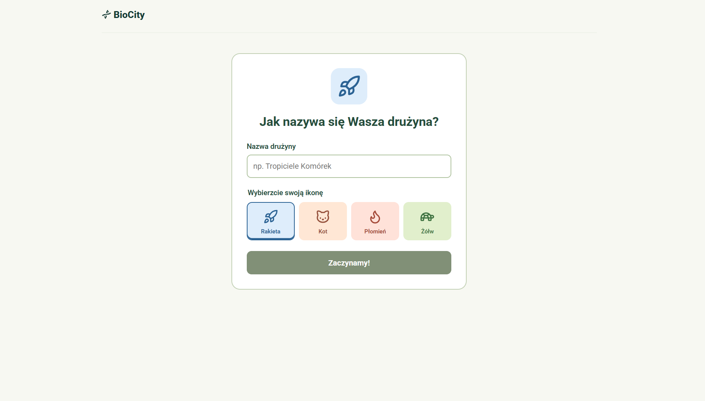
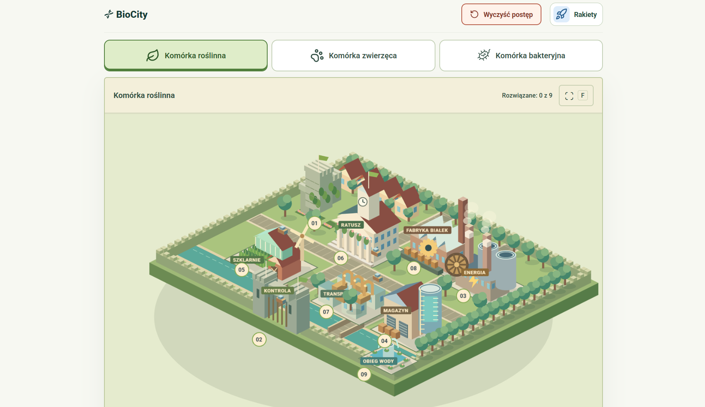
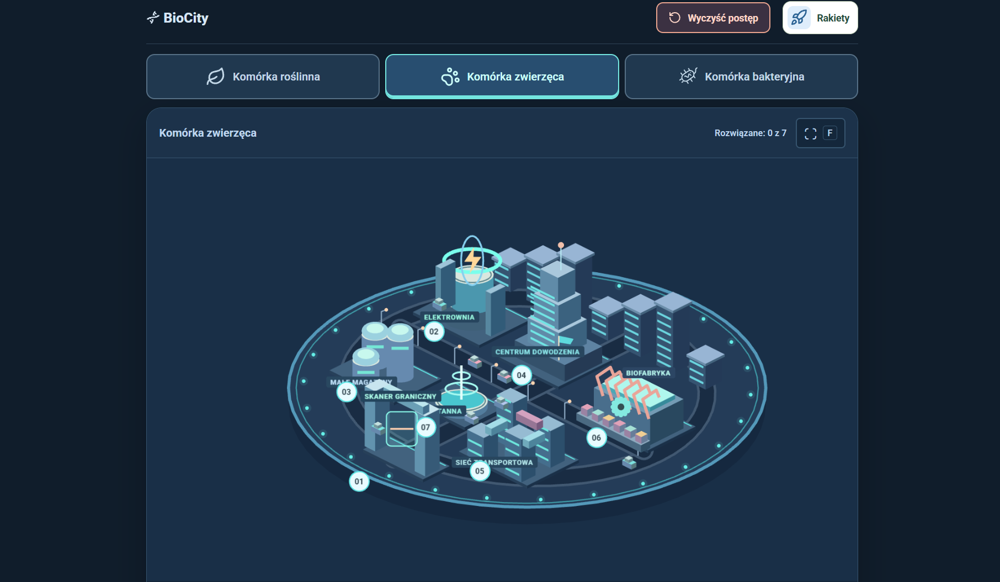
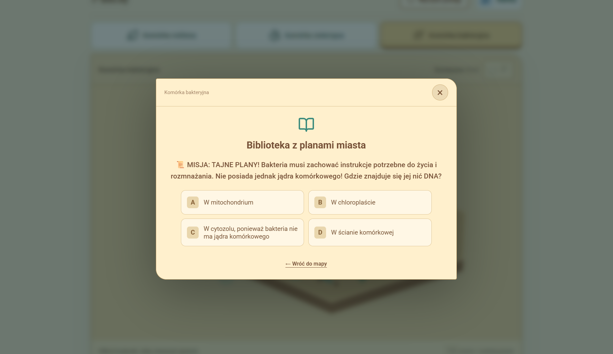

# BioCity

An educational game about cell structures, built with React, TypeScript, PixiJS, React Router, Zustand, and Dexie.

Architecture decisions and implementation notes: [documentation](docs/README.md).

## Getting started

The project uses Vite+, which provides the development server, production bundler, linter, formatter, and Vitest runner.

- `npm run dev` - start the local development server.
- `npm run build` - check TypeScript and create a production build.
- `npm run preview` - serve the production build locally.
- `npm run lint` - run static code analysis.
- `npm test` - run the business logic tests once with Vitest.
- `npm run test:watch` - run tests in watch mode.
- `npm run test:typecheck` - check types in the application and tests.

## PWA and installation

The manifest and service worker are also available through `npm run dev` at `http://localhost:5173`. Refresh the tab after changing the PWA configuration. Chrome checks whether the application is installable; the available installation action also depends on browser state, such as an existing installation or a previously dismissed prompt.

To test full offline support, run `npm run build` followed by `npm run preview` and open `http://localhost:4173`. Wait for the Polish message “Możesz teraz grać bez internetu” (“You can now play offline”), then switch the browser to offline mode and reload the page. The precache includes the separately loaded map and renderer modules. Development mode does not provide full offline support. Outside localhost, serve the application over HTTPS.

Updates require clicking “Wczytaj nową wersję” (“Load the new version”); the game does not reload automatically while players are answering questions. The manifest includes 192 px and 512 px PNG icons, a separate maskable icon, and a 180 px Apple icon based on the DNA favicon. Google Fonts remains optional: a local fallback font is used without a network connection.

## Cities and questions

Three tabs switch between cities and support the arrow keys, Home, and End. The URLs `/#/miasto/plant`, `/#/miasto/animal`, and `/#/miasto/bacteria` open a specific tab directly.

Each city has its own architecture, terrain, streets, and palette:

- Plant: gardens, greenhouses, canals, a water reservoir, and overgrown walls.
- Animal: an oval nighttime metropolis with glass towers, illuminated circuits, and a border scanner.
- Bacterial: a desert citadel with sandstone buildings, turquoise domes, a bazaar, and an aqueduct.

Clicking a building, its number, or a legend entry opens a question in a native modal dialog. The dialog blocks background interaction and page scrolling, keeps focus inside, and closes through a button, a backdrop click, or Escape. Closing it restores focus. A correct answer saves progress and marks the building on the map. On phones, the map scrolls horizontally; a button in the map header toggles fullscreen. Animations respect `prefers-reduced-motion`.

The review quiz unlocks after all questions in all three cities have been completed. Progress is stored in localStorage (`biocity-progress-v2`); resetting progress preserves question content.

If the browser blocks localStorage or storage runs out of space, the game keeps new progress in memory for the current session and displays a message explaining that it cannot save permanently. The map and PixiJS are loaded separately when the map is displayed. Animations respond to changes in `prefers-reduced-motion` and stop while the tab is hidden.

## Content and storage

Building definitions are stored in `src/data/initialPlaces.json`, with 21 completed questions in `src/data/initialQuestions.json`. Each question has a `questionId` key in the form `cityId:buildingId`. The application does not include a content editor or a cell comparison section.

Content is stored locally in IndexedDB (`biocity`, table `cityPlaces`). Initialization adds missing records and preserves existing browser content; changing a seed file does not overwrite the database. The v1 → v2 migration preserves the legacy table and copies content into independent records for each city. The data layer retains write conflict detection and observes Dexie `liveQuery` through `useSyncExternalStore`.

Roboto is imported in `src/styles/app.css` through the official Google Fonts CSS API (`fonts.googleapis.com`). The font requires a network connection; a local fallback is used while it loads and when offline. Questions, map graphics, and the Polish interface dictionary do not require external downloads. The bacterial icon is a custom SVG of a rod-shaped bacterium with a flagellum; the remaining icons come from `react-icons/lu`.

## Project structure

- `src/components/CityTabs.tsx` - accessible city tabs.
- `src/components/QuestionDialog.tsx` - question dialog.
- `src/pixi/cityDesign.ts` - city layouts, terrain, surroundings, and roads.
- `src/pixi/cityLandmarks.ts` - individual buildings and architectural details.
- `src/pixi/cityGeometry.ts` - isometric geometry.
- `src/pixi/createCityScene.ts` - rendering, interaction, animation, and resource cleanup.
- `src/store`, `src/lib` - progress, IndexedDB, and validation.

## Business logic tests

Tests in `tests/*.test.ts` use Vitest in a Node environment. They do not require Chrome or a running Vite server. They replaced the earlier browser tests and the `node:test` runner.

- `questions.test.ts` - question assignments, content independence after migration, question readiness, and stale content detection.
- `progress.test.ts` - cell completion, review unlock conditions, the next question, and scoring by `questionId`.
- `persistence.test.ts` - team validation and safe loading of older or malformed data.
- `progressStore.test.ts` - Zustand actions, independent completions, team editing, reset, and restoring saved state. Only the localStorage backend is replaced with memory; the store and persist middleware remain real.
- `resilientStorage.test.ts` - blocked access, read and removal failures, quota limits, and preserving newer progress within a session.
- `cityScene.test.ts` - changes in reduced motion and tab visibility, observer cleanup, and unmounting before initialization finishes. The renderer and geometry are mocked; these tests do not check WebGL output.

`vitest.config.ts` shares the Vite configuration and aliases. Tests do not verify PixiJS rendering, native IndexedDB, or browser behavior; those areas require manual verification.

## Teams and keyboard controls

On first launch, players enter a team name of up to 32 characters and choose one of four React Icons: a rocket, cat, flame, or turtle. The team button in the upper-right corner lets them edit these details later. The `team` field is saved with progress in `biocity-progress-v2`; resetting answers preserves the team. Older saves without a team retain progress and show the welcome form.

TanStack Hotkeys handles shortcuts only while the map view is mounted:

- `F`: toggle map fullscreen; if the browser rejects the Fullscreen API request, the map fills the browser window.
- `1-9`: open the question with that number. Pressing the same key again closes it; another number switches questions. Numbers without a question are ignored.
- Typing in form fields does not trigger shortcuts; holding a key does not repeatedly toggle the dialog.

The interface uses short text for 11-year-olds, biological cell names, and solid colors without gradients. Question and answer content remains unchanged.

`Tab` and `Shift+Tab` move focus between page controls. With focus on the tabs, the arrow keys, Home, and End select a cell. This keeps map buttons and other actions accessible by keyboard.

The application, tests, and tooling configuration use TypeScript `strict` mode.

## Game screenshots

